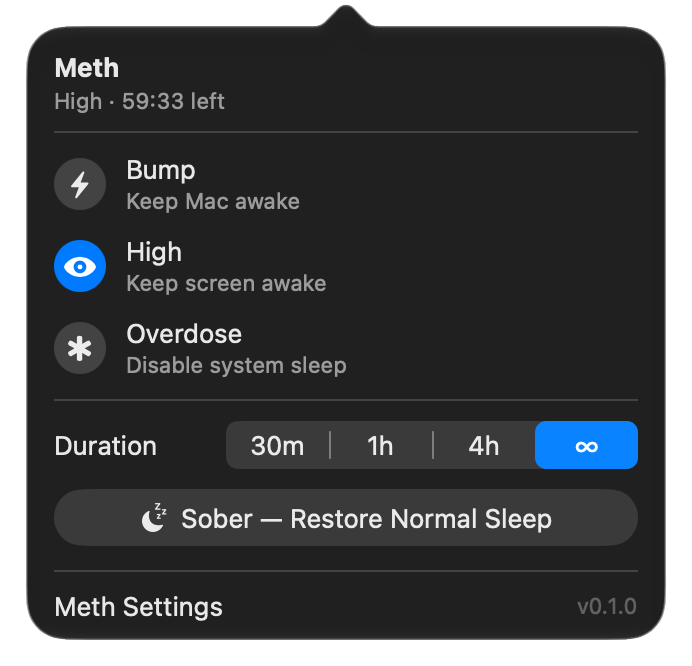
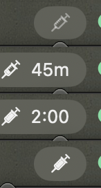

<p align="center">
  
</p>

<h1 align="center">Meth</h1>

<p align="center"><b>Keep your Mac high. Never asleep.</b><br>
Sleep control for humans and AI agents.</p>

<p align="center">
  English · <a href="README.th.md">ไทย</a> · <a href="README.zh-CN.md">简体中文</a>
</p>

<p align="center">
  
</p>

> **Parody notice.** Meth is a joke on drug-themed sleep-prevention apps. The names
> refer only to macOS power management. The app has nothing to do with drugs.

Meth is a tiny, native macOS menu bar app (Swift + SwiftUI, no Electron, no web views,
no telemetry) that stops your Mac from sleeping. You control it with one click or with the `meth`
command, which also makes it easy for scripts, CI jobs and AI coding agents to use.

## Features

| Mode | What it does | Equivalent |
|---|---|---|
| **Bump** | Prevents idle *system* sleep; the display may sleep | `caffeinate -i` |
| **High** | Prevents idle system sleep *and* display sleep | `caffeinate -di` |
| **Overdose** | High plus system-wide `disablesleep` (prevents even lid-close sleep). Needs a small admin helper; always time-limited or lease-protected, and always restored | `pmset -a disablesleep 1` |
| **Sober** | Releases everything and restores the original settings | — |

- **Duration:** 30m · 1h · 4h · ∞. Every timed session expires on its own, even if the app quits.
- **Readable at a glance:** the menu bar icon shows the mode, and the time left appears next to it.

  
- **One source of truth:** the app and the CLI talk to the same per-user controller, so they always agree.
- **Survives crashes and restarts:** timed sessions resume after an agent crash or reboot. Overdose never silently resumes after a reboot.
- **Native:** Light and Dark Mode, keyboard shortcuts (`1` `2` `3` modes, `0` sober), VoiceOver labels.
- **Languages:** English, ไทย (Thai), 简体中文 (Simplified Chinese), in both the app and the CLI.
- **Updates:** Sparkle 2 with EdDSA-signed updates over HTTPS.

## Install

1. Download **`Meth-<version>.dmg`** from [Releases](https://github.com/kroekkarawit/meth-macos/releases/latest).
2. Open it and drag **Meth** into **Applications**.
3. Launch Meth. It lives in the menu bar (no Dock icon).
4. Choose a mode.

Requirements: macOS 14 Sonoma or later, Apple silicon or Intel (universal binary).

macOS may report *"Meth added items that can run in the background."* That item is Meth's
small session controller (see [Architecture](docs/ARCHITECTURE.md)). It exits on its own
when nothing is active.

## Command line

Install from the menu: **Meth Settings → Install Command Line Tool…** This creates the symlink
`~/.local/bin/meth` to the copy inside Meth.app, so it updates together with the app.

```bash
meth high --for 2h        # keep Mac and display awake for 2 hours
meth bump --for 30m       # keep Mac awake, display may sleep
meth bump                 # until `meth sober`
meth status               # human-readable
meth status --json        # stable machine-readable schema
meth sober                # restore normal sleep (alias: meth stop)
meth overdose --for 1h    # requires enabling it in the app first (see below)
```

```text
$ meth status
Meth v0.1.0
Mode: High
Status: Active
Remaining: 01:42:15
```

Durations: `45s`, `15m`, `90m`, `2h`, `1h30m`, `1d`, `inf`. Full reference, JSON
schema and exit codes: **[docs/CLI.md](docs/CLI.md)**.

## For AI agents (Claude Code, Codex, …)

Use the CLI. No MCP server and no GUI automation needed:

```bash
prev="$(meth status --json)"
meth high --for 2h
trap 'meth sober >/dev/null' EXIT   # or restore "$prev"; see docs/CLI.md
npm run build
```

- Parse `meth status --json`. Keys never disappear and absent values are `null`.
- Rely on exit codes: `0` ok, `2` usage, `3` Meth not reachable, `4` Overdose not allowed, `5` power operation failed.
- **Overdose is off-limits to the CLI by default.** A human must enable
  *Allow Overdose from Command Line* in the app. Even then it needs `--for` (≤ 24h) and
  is still bounded by the privileged helper. Agents never get root.

See [docs/CLI.md#ai-agents](docs/CLI.md#ai-agents) for a drop-in `AGENTS.md`/`CLAUDE.md` snippet.

## Overdose, safely

Overdose changes a **system-wide** setting, so it is fenced in:

- A narrow root LaunchDaemon can do exactly two things: set `disablesleep 1` and restore the **original** value.
  It is installed via `SMAppService`, and *you* approve it in System Settings › General › Login Items.
- It only accepts calls from Meth's agent, signed by the same Developer ID team.
- It records the original value *before* changing anything, enforces its own deadline,
  and restores at boot. Indefinite Overdose uses a 10-minute lease that the app must keep renewing.
- If something else had already disabled sleep, Meth leaves it alone. If you re-enable sleep
  yourself mid-session, Meth won't overwrite your change.

Not every Mac honours `disablesleep`. Meth verifies the setting took effect and otherwise
reports Overdose as unsupported. No software can override hardware-enforced sleep (e.g. thermal emergencies).

## Updates

Meth checks the HTTPS feed `https://github.com/kroekkarawit/meth-macos/releases/latest/download/appcast.xml` once a day
(**Meth Settings → Automatically Check for Updates**), or on demand (**Check for Updates…**).
Updates are EdDSA-signed and notarized, and Sparkle verifies them before installing. An active session keeps running through an update.

## Build from source

```bash
brew install xcodegen          # project is generated from project.yml
./Scripts/build.sh             # universal Release → dist/Meth.app (ad-hoc signed)
./Scripts/test.sh              # unit tests + localization coverage
open dist/Meth.app
```

Details: [DEVELOPMENT.md](docs/DEVELOPMENT.md) · Releases: [RELEASE.md](docs/RELEASE.md) ·
Design: [ARCHITECTURE.md](docs/ARCHITECTURE.md) · [SECURITY.md](SECURITY.md) ·
[TROUBLESHOOTING.md](docs/TROUBLESHOOTING.md)

## Known limitations

- Bump/High cannot stop clamshell (lid-closed) sleep on battery. That's macOS policy, and only Overdose changes it.
- Overdose depends on the hardware honouring `disablesleep`, and requires approving the helper.
- Indefinite sessions do not survive a restart, by design. Timed Bump/High sessions do.
- The menu bar time label updates once per minute (to keep CPU wake-ups low). The popover shows seconds.

## Contributing & license

PRs welcome. See [CONTRIBUTING.md](CONTRIBUTING.md). Licensed under the [MIT License](LICENSE).
