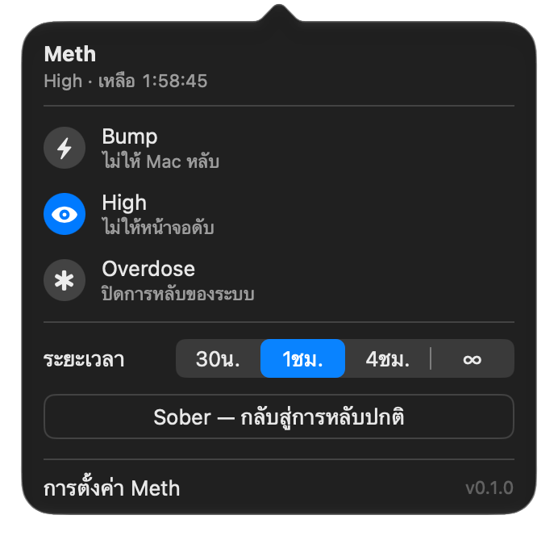

<p align="center">
  
</p>

<h1 align="center">Meth</h1>

<p align="center"><b>Keep your Mac high. Never asleep.</b><br>
ควบคุมการหลับของ Mac สำหรับมนุษย์และเอเจนต์ AI</p>

<p align="center">
  <a href="README.md">English</a> · ไทย · <a href="README.zh-CN.md">简体中文</a>
</p>

<p align="center">
  
</p>

> **หมายเหตุ:** Meth เป็นการล้อเลียนแอปกันเครื่องหลับที่ตั้งชื่อเกี่ยวกับยาเสพติด
> ชื่อทั้งหมดหมายถึงการจัดการพลังงานของ macOS เท่านั้น ไม่มีเนื้อหาเกี่ยวกับยาเสพติดใด ๆ

Meth เป็นแอปบนแถบเมนูของ macOS ขนาดเล็ก เขียนด้วย Swift/SwiftUI แบบเนทีฟ (ไม่มี Electron,
ไม่มีเว็บวิว, ไม่เก็บข้อมูลการใช้งาน) ใช้ป้องกันไม่ให้ Mac หลับ สั่งงานได้ด้วยคลิกเดียวหรือด้วยคำสั่ง `meth`
ซึ่งสคริปต์ งาน CI และเอเจนต์ AI ใช้งานได้ทันที

## โหมด

| โหมด | ทำอะไร | เทียบเท่า |
|---|---|---|
| **Bump** | ไม่ให้ระบบหลับเมื่อไม่มีการใช้งาน แต่จอดับได้ | `caffeinate -i` |
| **High** | ไม่ให้ทั้งระบบและจอหลับ | `caffeinate -di` |
| **Overdose** | High + ปิดการหลับทั้งระบบ (รวมตอนพับฝา) ต้องติดตั้งตัวช่วยผู้ดูแลระบบ มีเวลาจำกัดเสมอและคืนค่าเดิมอัตโนมัติ | `pmset -a disablesleep 1` |
| **Sober** | ปล่อยทุกอย่างและคืนค่าการตั้งค่าเดิม | — |

- ระยะเวลา 30 นาที · 1 ชม. · 4 ชม. · ∞ หมดเวลาแล้วกลับเป็น Sober เองแม้แอปจะปิดไปแล้ว
- ไอคอนบนแถบเมนูบอกโหมดได้ทันที: เข็มสีเทาจาง = Sober, เติมบางส่วน = Bump, เติมเต็ม = High, สีส้ม = Overdose และแสดงเวลาที่เหลือข้าง ๆ
- แอปและ CLI ใช้ตัวควบคุมเดียวกัน สถานะจึงตรงกันเสมอ
- รองรับภาษาอังกฤษ ไทย และจีนตัวย่อ ทั้งในแอปและ CLI (เปลี่ยนได้ที่ การตั้งค่า Meth › ภาษา)

## ติดตั้ง

1. ดาวน์โหลด **`Meth-<เวอร์ชัน>.dmg`** จาก [Releases](https://github.com/kroekkarawit/meth-macos/releases/latest)
2. เปิดไฟล์แล้วลาก **Meth** ไปไว้ใน **Applications**
3. เปิด Meth จะอยู่บนแถบเมนู (ไม่มีไอคอนใน Dock)
4. เลือกโหมด

ต้องใช้ macOS 14 ขึ้นไป รองรับทั้ง Apple silicon และ Intel

## บรรทัดคำสั่ง

ติดตั้งจากเมนู **การตั้งค่า Meth → ติดตั้งเครื่องมือบรรทัดคำสั่ง…**

```bash
meth high --for 2h      # ไม่ให้ Mac และจอหลับ 2 ชั่วโมง
meth bump --for 30m
meth status --json      # สำหรับสคริปต์และเอเจนต์ AI
meth sober              # กลับสู่การหลับปกติ
meth status --lang th   # แสดงผลภาษาไทย (หรือตั้ง METH_LANG=th)
```

ผลลัพธ์ JSON และรหัสการออกไม่ขึ้นกับภาษา รายละเอียดอยู่ที่ [docs/CLI.md](docs/CLI.md)

## ความปลอดภัยของ Overdose

- ตัวช่วยที่รันด้วยสิทธิ์ root ทำได้เพียงสองอย่าง คือเปิด `disablesleep` และคืน **ค่าเดิม** ผู้ใช้ต้องอนุญาตเองใน การตั้งค่าระบบ › ทั่วไป › รายการล็อกอิน
- รับคำสั่งเฉพาะจากตัวควบคุมของ Meth ที่เซ็นด้วยทีม Developer ID เดียวกัน
- บันทึกค่าเดิมก่อนเปลี่ยนเสมอ มีกำหนดเวลาของตัวเอง และคืนค่าเมื่อรีสตาร์ต
- CLI ใช้ Overdose ไม่ได้จนกว่าผู้ใช้จะเปิด “อนุญาต Overdose จากบรรทัดคำสั่ง” ในแอป

## สัญญาอนุญาต

MIT. ดู [LICENSE](LICENSE)
