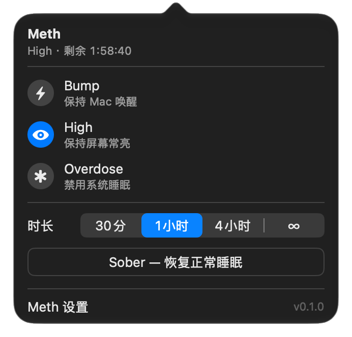

<p align="center">
  
</p>

<h1 align="center">Meth</h1>

<p align="center"><b>Keep your Mac high. Never asleep.</b><br>
为人类和 AI 智能体打造的 Mac 睡眠控制工具。</p>

<p align="center">
  <a href="README.md">English</a> · <a href="README.th.md">ไทย</a> · 简体中文
</p>

<p align="center">
  
</p>

> **戏仿声明：** Meth 是对那些以毒品命名的防睡眠应用的戏仿。所有名称仅指 macOS 电源管理，
> 与毒品没有任何关系。

Meth 是一款小巧的原生 macOS 菜单栏应用（Swift/SwiftUI，无 Electron、无网页视图、无遥测），
用于阻止 Mac 进入睡眠。一键即可切换，也可以使用 `meth` 命令，方便脚本、CI 和 AI 编程智能体调用。

## 模式

| 模式 | 作用 | 等价于 |
|---|---|---|
| **Bump** | 阻止系统闲置睡眠，显示器可以关闭 | `caffeinate -i` |
| **High** | 阻止系统和显示器闲置睡眠 | `caffeinate -di` |
| **Overdose** | High + 全局禁用睡眠（包括合盖）。需要特权助手，始终有时间限制并自动恢复原值 | `pmset -a disablesleep 1` |
| **Sober** | 释放全部并恢复原始设置 | — |

- 时长：30 分钟 · 1 小时 · 4 小时 · ∞。到时自动恢复，即使应用已退出。
- 菜单栏图标一眼可见当前模式：灰色空针筒 = Sober，部分填充 = Bump，填满 = High，橙色 = Overdose，并显示剩余时间。
- 应用与命令行共用同一个控制器，状态始终一致。
- 支持英语、泰语、简体中文（应用与命令行均支持，可在 Meth 设置 › 语言 中切换）。

## 安装

1. 从 [Releases](https://github.com/kroekkarawit/meth-macos/releases/latest) 下载 **`Meth-<版本>.dmg`**。
2. 打开后将 **Meth** 拖入 **应用程序**。
3. 启动 Meth，它位于菜单栏（无程序坞图标）。
4. 选择模式。

需要 macOS 14 或更高版本，支持 Apple 芯片和 Intel（通用二进制）。

## 命令行

在菜单中选择 **Meth 设置 → 安装命令行工具…**

```bash
meth high --for 2h      # 2 小时内保持 Mac 和屏幕唤醒
meth bump --for 30m
meth status --json      # 供脚本和 AI 智能体使用
meth sober              # 恢复正常睡眠
meth status --lang zh   # 中文输出（或设置 METH_LANG=zh）
```

JSON 输出和退出码与语言无关。完整说明见 [docs/CLI.md](docs/CLI.md)。

## Overdose 的安全性

- root 助手只能做两件事：开启 `disablesleep`，以及恢复**原始值**。需要你在“系统设置 › 通用 › 登录项”中批准。
- 只接受由同一 Developer ID 团队签名的 Meth 控制器的请求。
- 修改前先记录原始值，自行执行到期时间，并在重启时恢复。
- 在应用中开启“允许从命令行使用 Overdose”之前，命令行无法使用 Overdose。

## 许可证

MIT，详见 [LICENSE](LICENSE)。
